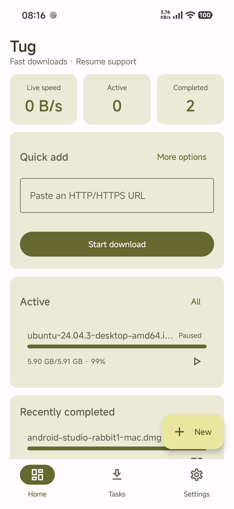
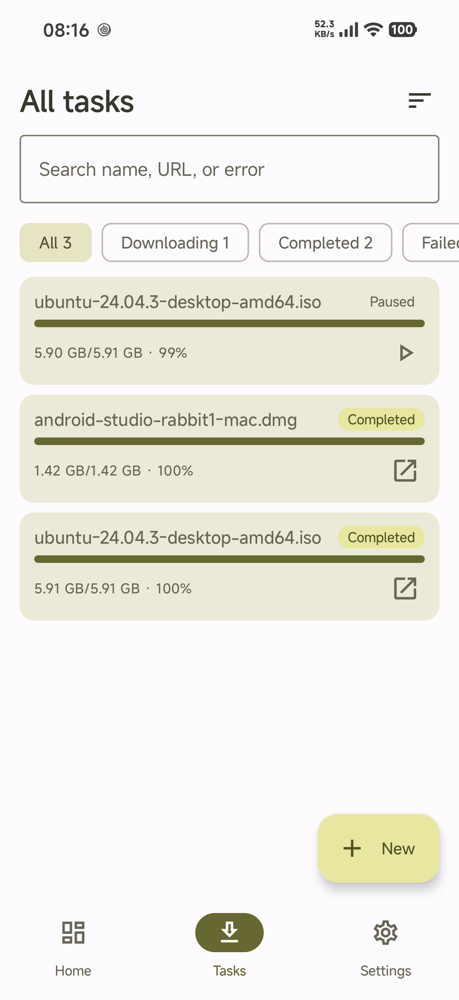
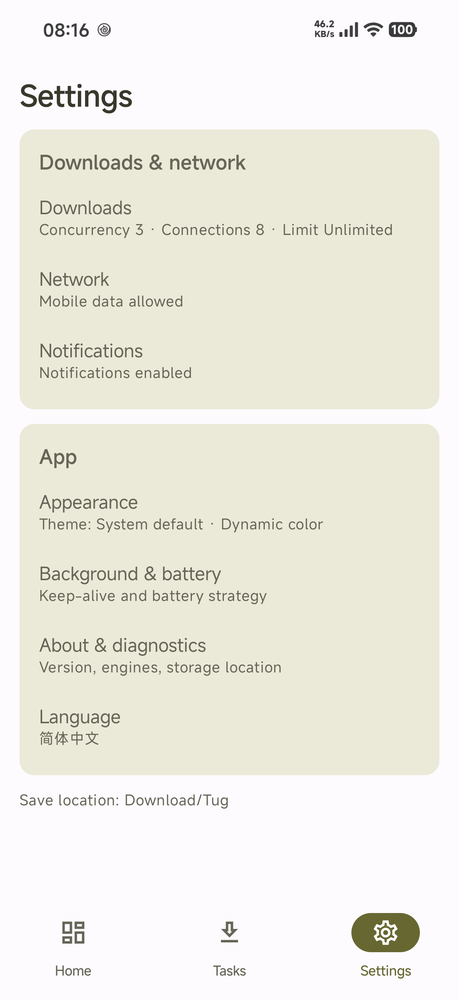
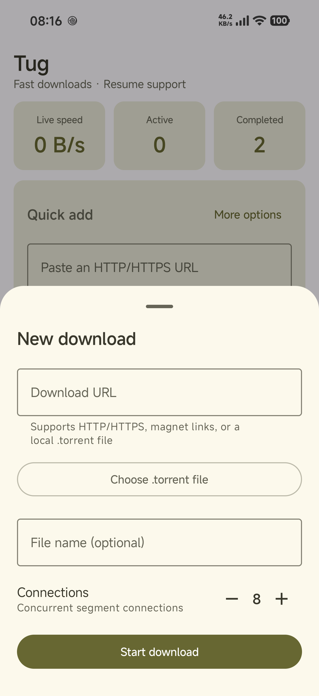

<h1 align="center">
   Tug-Android
</h1>

<p align="center">Multi-connection HTTP/HTTPS and BitTorrent downloader · Reusable Kotlin libraries</p>

<p align="center">
  <a href="README.md">简体中文</a> · <a href="README.zh-TW.md">繁體中文</a> · <b>English</b>
</p>

<p align="center">
  <a href="https://central.sonatype.com/artifact/io.github.mtdhllf/tug-engine-core"></a>
  
  
  
  <a href="public/LICENSE"></a>
</p>

---

Tug-Android is the Android version of [Tug](https://github.com/mtdhllf/Tug-Desktop). The desktop (Rust) version focuses on BitTorrent and Windows integration. The Android app focuses on **multi-connection HTTP/HTTPS downloads, resume support, and background downloads**, while exposing its download core as lightweight Kotlin libraries.

### Highlights

- Complete HTTP/HTTPS multi-connection downloader with resume, background downloading, and public Downloads publishing.
- BitTorrent/magnet downloads powered by libtorrent4j, with Files/Peers/Trackers details.
- Five reusable libraries: `tug-engine-core`, `tug-http`, `tug-http-okhttp`, `tug-store-sqlite`, and `tug-engine-torrent`, including both JDK and OkHttp HTTP implementations.
- Two minimal demos, `sample-http` and `sample-torrent`, covering initialization, settings, list state, pause/resume/delete. The HTTP demo contains both JDK and OkHttp implementations.

---

## Screenshots

| Home | Tasks | Settings | New download |
|---|---|---|---|
|  |  |  |  |

---

## Features

### Downloading
- HTTP/HTTPS multi-connection segmented downloads, 1–32 connections
- Resume support: `.part` file plus metadata (segment completion and in-segment offset checkpoint, 1-second granularity)
- Pause/resume, retry on failure, automatic redirects (≤10)
- ETag / Last-Modified / content-length validation
- SHA-256 verification (engine support; UI integration pending)
- Global download rate limit, Wi-Fi-only mode, automatic pause/resume when connectivity changes
- Publishes completed files to **`Download/Tug`** (MediaStore on Android 10+, direct writes on Android 9 and below)
- Never overwrites existing files (automatic `name (1).ext`)

### Tasks and UI
- Home: stats, quick add, active downloads, recently completed
- Task list: search, filters (all/downloading/completed/failed), sorting (recent/speed/name), long-press multi-select batch actions
- Task details: full progress, speed, ETA, save location, copy URL, open/share file, delete confirmation
- Six settings sections: download, network, notifications, appearance (light/dark/system/dynamic color), background and battery, about
- Foreground service + notifications: progress, completed/failed, pause all; tap a notification to open the task
- Share intent handling (links/torrents) and `tug://task/{id}` deep links
- Multilingual UI (Simplified Chinese, Traditional Chinese, English, Spanish, Hindi, Arabic)

### Download Libraries

Five libraries under groupId `io.github.mtdhllf` (published to Maven Central; project dependencies can also be used directly inside this repository):

Current version: 

| Coordinate | Contents |
|---|---|
| `io.github.mtdhllf:tug-engine-core` | Engine contracts + task/state/settings/event models + `TaskManager`/`TaskStore` |
| `io.github.mtdhllf:tug-http` | HTTP multi-connection segmented engine (JDK `HttpURLConnection` by default) |
| `io.github.mtdhllf:tug-http-okhttp` | OkHttp implementation of the HTTP engine (choose one) |
| `io.github.mtdhllf:tug-store-sqlite` | Persistent storage for tasks and settings |
| `io.github.mtdhllf:tug-engine-torrent` | BitTorrent/magnet engine (libtorrent4j) |

```kotlin
implementation("io.github.mtdhllf:tug-engine-core:1.0.0")
implementation("io.github.mtdhllf:tug-http:1.0.0")          // or
implementation("io.github.mtdhllf:tug-http-okhttp:1.0.0")
implementation("io.github.mtdhllf:tug-store-sqlite:1.0.0")  // Android, optional
implementation("io.github.mtdhllf:tug-engine-torrent:1.0.0") // Android, optional
```

> Public API and integration guide: [`public/API.en.md`](public/API.en.md).

### Demo Projects

| Module | Engine | What it demonstrates |
|---|---|---|
| `sample-http` | `HttpDownloadEngine` (JDK) + `OkHttpDownloadEngine` | Initialization, common settings, task list state, pause/resume/delete |
| `sample-torrent` | `TorrentDownloadEngine` (libtorrent4j) | magnet / `.torrent` URL / local `.torrent` file, list state, Peers, pause/resume/delete |

`sample-http` depends on both `tug-http` and `tug-http-okhttp`; switch the implementation in `DemoApp.kt`:

```kotlin
// false = JDK HttpURLConnection; true = OkHttp
private const val USE_OKHTTP = false
```

Both demos use `InMemoryTaskStore` (tasks do not survive process restarts) and an app-private download directory. They intentionally omit notifications, foreground services, and MediaStore publishing, focusing on the **library API**.

```bash
./gradlew :sample-http:assembleDebug :sample-torrent:assembleDebug
adb install -r -t sample-http/build/outputs/apk/debug/sample-http-debug.apk
adb install -r -t sample-torrent/build/outputs/apk/debug/sample-torrent-debug.apk
```

You can also run both modules directly in Android Studio.

### Library Integration / API

#### 1. Initialization

Create one `TaskManager` in your `Application` or DI container (it owns the queue, concurrency, state, and progress):

```kotlin
class App : Application() {
    lateinit var manager: TaskManager
    private val scope = CoroutineScope(SupervisorJob() + Dispatchers.Default)

    override fun onCreate() {
        super.onCreate()

        val engine = HttpDownloadEngine(scope = scope)
        // With OkHttp: val engine = OkHttpDownloadEngine(scope = scope)
        // With persistence: val store = SqliteTaskStore(this)
        val downloadDir = File(getExternalFilesDir(null), "downloads").apply { mkdirs() }

        manager = TaskManager(
            store = InMemoryTaskStore(),          // or SqliteTaskStore(this)
            engines = mapOf("http" to engine),
            scope = scope,
            defaultDownloadDir = downloadDir.absolutePath,
            initialSettings = Settings(connectionsPerTask = 4, maxConcurrentTasks = 2),
            deleter = TaskFileDeleter { task -> File(task.path).delete() },
        )
        scope.launch { manager.bootstrap() }
    }
}
```

Android requires the `INTERNET` permission.

#### 2. Common Settings

```kotlin
manager.applySettings(
    Settings().apply {
        connectionsPerTask = 4
        maxConcurrentTasks = 2
        globalDownloadLimitKib = 512 // null = unlimited
    },
)
```

Settings take effect on running tasks immediately (connection count applies the next time a task starts; rate limit and concurrency apply immediately).

#### 3. Task Operations

```kotlin
val id = manager.add(NewTask(url = "https://example.com/file.zip")) // enqueue and start
manager.pause(id)
manager.resume(id)
manager.remove(id, deleteFiles = true)

// Observe in Compose (or collect into your own state layer)
val tasks by manager.tasks.collectAsState()
val stats by manager.stats.collectAsState()
```

State semantics:
- Only `Queued` tasks start automatically; `Failed` tasks require an explicit `resume(id)`.
- `manager.tasks` combines persisted fields with real-time engine progress (about 500ms updates); the UI does not need to poll.
- Pause/remove cancels in-flight connections. Completed tasks stay in the list unless `remove` is called.

#### 4. Storage and BitTorrent

- `tug-store-sqlite` provides `SqliteTaskStore` (native Android SQLite) and `SettingsRepository` (SharedPreferences). You can also implement the `TaskStore` interface yourself.
- BitTorrent requires `tug-engine-torrent`; register the engine in the same `TaskManager`:

```kotlin
val bt = TorrentDownloadEngine(
    workDir = File(filesDir, "torrent").apply { mkdirs() },
    scope = scope,
)
val manager = TaskManager(
    store = SqliteTaskStore(this),
    engines = mapOf("http" to httpEngine, "torrent" to bt),
    scope = scope,
    defaultDownloadDir = downloadDir.absolutePath,
)
manager.add(NewTask(url = "magnet:?xt=urn:btih:...", kind = TaskKind.Torrent))
```

The BT library includes `armeabi-v7a`, `arm64-v8a`, `x86`, and `x86_64` by default.  
To reduce APK size, keep only the ABIs you need:

```kotlin
android {
    defaultConfig {
        ndk { abiFilters += listOf("arm64-v8a") }
    }
}
```

See [`public/API.en.md`](public/API.en.md) for the full API contract and semantics.

---

## Project Structure

```
Tug-Android/
├─ app/                       Compose UI + foreground service + storage publishing
├─ core/
│  ├─ engine-core/             Engine contracts + models + TaskManager/TaskStore (tug-engine-core)
│  ├─ engine-http/            Pure JVM HTTP engine (tug-http, JDK transport)
│  ├─ engine-okhttp/          OkHttp transport (tug-http-okhttp)
│  ├─ store-sqlite/           Native SQLite TaskStore + settings (tug-store-sqlite)
│  └─ engine-torrent/         BitTorrent engine (tug-engine-torrent)
├─ sample-http/               JDK + OkHttp HTTP integration demo (Compose)
├─ sample-torrent/            BT/magnet integration demo (Compose)
├─ samples/jvm-downloader/    Pure JVM CLI sample
└─ gradle/                    Version catalog and wrapper
```

Key dependencies: Kotlin 2.2.10 / AGP 9.4.1 / Compose BOM / kotlinx-coroutines / kotlinx-serialization.  
The HTTP core uses JDK `HttpURLConnection` by default (no third-party HTTP dependency). Hosts can inject their own client through `HttpTransport`.  
The task store uses **native Android SQLite (`SQLiteOpenHelper`)**, without Room or KSP.

---

## Build

Requirements:
- JDK 17 (Gradle toolchain) and JDK 25 (Gradle daemon, see `gradle/gradle-daemon-jvm.properties`)
- Android SDK: platform **android-37**, build-tools **37.0.0**
- Set `sdk.dir` in `local.properties`

```bash
# Debug
./gradlew :app:assembleDebug

# Unit tests
./gradlew :core:engine-core:test :core:engine-http:test :core:engine-okhttp:test :app:testDebugUnitTest

# Demos
./gradlew :sample-http:assembleDebug :sample-torrent:assembleDebug

# Instrumented tests (start the app manually first; otherwise ActivityScenario may not get a foreground window)
./gradlew :app:assembleDebugAndroidTest
adb install -r -t app/build/outputs/apk/debug/app-debug.apk
adb install -r -t app/build/outputs/apk/androidTest/debug/app-debug-androidTest.apk
adb shell am instrument -w -e class com.github.mtdhllf.tug.ui.MainUiTest \
  com.github.mtdhllf.tug.test/androidx.test.runner.AndroidJUnitRunner

# Release (AAB / APK)
./gradlew :app:assembleRelease
```

### Signing

Create `keystore.properties` in the repository root:

```properties
storeFile=/absolute/path/to/app.jks
storePassword=******
keyAlias=******
keyPassword=******
```

---

## Tests

| Level | Coverage |
|---|---|
| JVM unit tests | 25 engine cases (segments/resume/pause/single stream/rate limit/fake completion), 5 orchestration cases, OkHttp transport, network policy, formatting, orphan cleanup |
| Instrumented tests | Native SQLite persistence, settings persistence, publishing to Downloads, end-to-end downloads, app wiring, pause/resume, Compose UI (navigation/new-task validation) |
| Demo checks | `sample-http` / `sample-torrent` launch on device, initialization/settings/list/new-task UI; pause/resume/delete implemented |
| Device acceptance | 10MB/20MB real downloads, 100MB pause test, notifications, deep links, release installation |

> UI tests pause 700ms between actions for easier visual inspection.

---

## Roadmap

- ✅ v1.0.0: HTTP/HTTPS multi-connection downloads, resume, background downloads, public Downloads publishing, full UI, deep links/share, BitTorrent/magnet (libtorrent4j), file selection toggle, Files/Peers/Trackers details, 5 reusable libraries and demos, multilingual UI (6 languages)
- Planned: fastresume improvements, repeatable BT network tests, background BT/FGS

---

## License

Apache-2.0, see [LICENSE](public/LICENSE).


