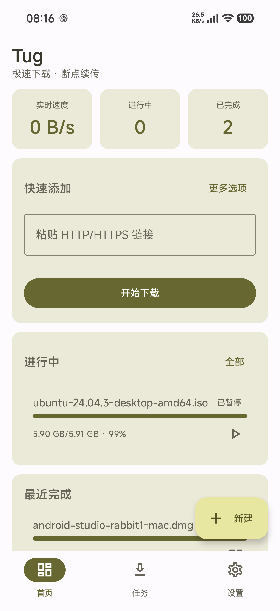
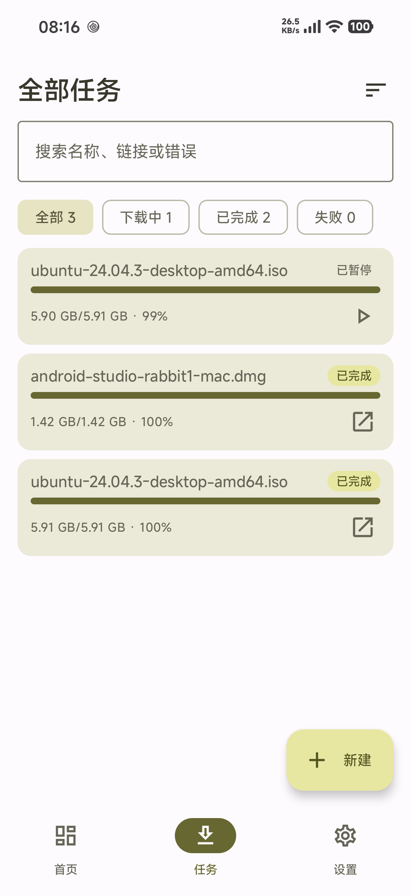
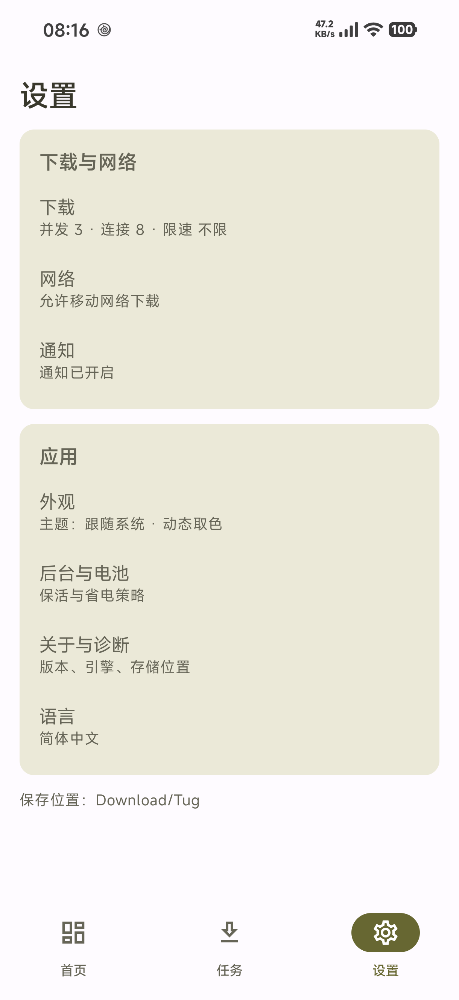
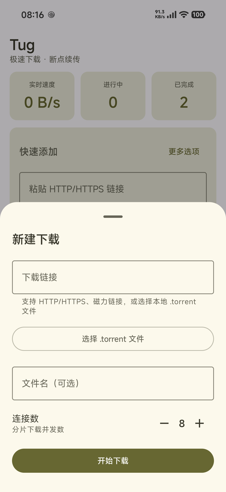

<h1 align="center">
   Tug-Android
</h1>

<p align="center">多连接 HTTP/HTTPS 与 BitTorrent 下载器 · 可复用 Kotlin 下载库</p>

<p align="center">
  <b>简体中文</b> · <a href="README.zh-TW.md">繁體中文</a> · <a href="README.en.md">English</a>
</p>

<p align="center">
  <a href="https://github.com/mtdhllf/Tug-Android/releases/latest"></a>
  
  
  
  
</p>

---

Tug-Android 是 [Tug](https://github.com/mtdhllf/Tug-Desktop) 的 Android 版本。桌面端（Rust）侧重 BitTorrent 与 Windows 集成；Android 端以 **HTTP/HTTPS 多连接下载、断点续传、后台下载** 为核心，同时把下载内核拆成可对外复用的轻量 Kotlin 库。

### 项目成果

- 完成 HTTP/HTTPS 多连接下载、断点续传、后台下载与公共目录发布。
- 完成 BitTorrent/magnet 下载（libtorrent4j），提供 Files/Peers/Trackers 详情。
- 下载内核拆为 5 个可复用库（`tug-engine-core`、`tug-http`、`tug-http-okhttp`、`tug-store-sqlite`、`tug-engine-torrent`），包含 JDK / OkHttp 两套 HTTP 实现。
- 提供 `sample-http`、`sample-torrent` 两个最小接入 Demo，覆盖初始化、设置、列表状态、暂停/继续/删除；HTTP Demo 同时集成 JDK/OkHttp 两套实现。

---

## 截图

| 首页 | 任务列表 | 设置 | 新建下载 |
|---|---|---|---|
|  |  |  |  |

---

## 功能

### 下载
- HTTP/HTTPS 多连接分段下载，连接数 1–32
- 断点续传：`.part` + 元数据（分片完成 + 片内偏移 checkpoint，1 秒粒度）
- 暂停/继续、失败重试、自动重定向（≤10 次）
- ETag / Last-Modified / 文件大小一致性校验
- SHA-256 校验（引擎支持，UI 待接入）
- 全局下载限速、仅 Wi-Fi、断网自动暂停/恢复
- 完成后发布到公共下载目录 **`Download/Tug`**（Android 10+ 走 MediaStore，9 及以下直写）
- 绝不覆盖已有文件（同名自动 `name (1).ext`）

### 任务与界面
- 首页（统计 / 快速添加 / 进行中 / 最近完成）
- 任务列表：搜索、筛选（全部/下载中/已完成/失败）、排序（最近/速度/名称）、长按多选批量操作
- 任务详情：完整进度、速度、ETA、保存位置、复制链接、打开/分享文件、删除确认
- 设置六子页：下载、网络、通知、外观（浅色/深色/跟随系统/动态取色）、后台与电池、关于
- 前台服务 + 通知：进度、完成/失败、全部暂停；通知点击直达任务详情
- 分享接收（链接/种子）与 `tug://task/{id}` 深链
- 多语言界面（简体中文、繁體中文、English、Español、हिन्दी、العربية）

### 下载核心库

五个库（groupId `io.github.mtdhllf`；已发布至 Maven Central，也可在仓库内直接使用 project 依赖）：

当前版本：

| 坐标 | 内容 |
|---|---|
| `io.github.mtdhllf:tug-engine-core` | 引擎契约 + 任务/状态/设置/事件模型 + `TaskManager`/`TaskStore` |
| `io.github.mtdhllf:tug-http` | HTTP 多连接分段引擎（JDK HttpURLConnection 默认实现） |
| `io.github.mtdhllf:tug-http-okhttp` | HTTP 引擎的 OkHttp 实现（已有 OkHttp 依赖时二选一） |
| `io.github.mtdhllf:tug-store-sqlite` | 任务与设置的持久化存储 |
| `io.github.mtdhllf:tug-engine-torrent` | BitTorrent/magnet 引擎（libtorrent4j） |

```kotlin
implementation("io.github.mtdhllf:tug-engine-core:1.0.0")
implementation("io.github.mtdhllf:tug-http:1.0.0")          // 或
implementation("io.github.mtdhllf:tug-http-okhttp:1.0.0")
implementation("io.github.mtdhllf:tug-store-sqlite:1.0.0")  // Android，可选
implementation("io.github.mtdhllf:tug-engine-torrent:1.0.0") // Android，可选
```

> 公开 API 与接入说明见 [`public/API.md`](public/API.md)。

### Demo 工程

| 模块 | 引擎 | 演示内容 |
|---|---|---|
| `sample-http` | `HttpDownloadEngine`（JDK）+ `OkHttpDownloadEngine` | 初始化、常用设置、下载列表状态、暂停/继续/删除 |
| `sample-torrent` | `TorrentDownloadEngine`（libtorrent4j） | magnet / `.torrent` URL / 本地 `.torrent` 文件、列表状态、Peers、暂停/继续/删除 |

`sample-http` 同时依赖 `tug-http` 与 `tug-http-okhttp`，在 `DemoApp.kt` 中切换：

```kotlin
// false = JDK HttpURLConnection；true = OkHttp
private const val USE_OKHTTP = false
```

两个 Demo 都使用 `InMemoryTaskStore`（进程重启任务不保留）和 App 私有下载目录，不包含通知/前台服务/MediaStore 发布，**重点展示库 API**。

```bash
./gradlew :sample-http:assembleDebug :sample-torrent:assembleDebug
adb install -r -t sample-http/build/outputs/apk/debug/sample-http-debug.apk
adb install -r -t sample-torrent/build/outputs/apk/debug/sample-torrent-debug.apk
```

也可以在 Android Studio 中直接运行两个模块。

### 库接入 / API 说明

#### 1. 初始化

在 `Application` 或 DI 容器创建一次 `TaskManager`（负责队列、并发、状态、进度）：

```kotlin
class App : Application() {
    lateinit var manager: TaskManager
    private val scope = CoroutineScope(SupervisorJob() + Dispatchers.Default)

    override fun onCreate() {
        super.onCreate()

        val engine = HttpDownloadEngine(scope = scope)
        // 已有 OkHttp 时：val engine = OkHttpDownloadEngine(scope = scope)
        // 需要持久化时：val store = SqliteTaskStore(this)
        val downloadDir = File(getExternalFilesDir(null), "downloads").apply { mkdirs() }

        manager = TaskManager(
            store = InMemoryTaskStore(),          // 或 SqliteTaskStore(this)
            engines = mapOf("http" to engine),
            scope = scope,
            defaultDownloadDir = downloadDir.absolutePath,
            initialSettings = Settings(connectionsPerTask = 4, maxConcurrentTasks = 2),
            deleter = TaskFileDeleter { task -> File(task.path).delete() },
        )
        scope.launch { manager.bootstrap() }
    }
}
```

Android 需要 `INTERNET` 权限。

#### 2. 常用设置

```kotlin
manager.applySettings(
    Settings().apply {
        connectionsPerTask = 4
        maxConcurrentTasks = 2
        globalDownloadLimitKib = 512 // null = 不限速
    },
)
```

设置对运行中的任务即时生效（连接数在下次启动任务时生效，限速/并发立即生效）。

#### 3. 任务操作

```kotlin
val id = manager.add(NewTask(url = "https://example.com/file.zip")) // 入队并自动开始
manager.pause(id)
manager.resume(id)
manager.remove(id, deleteFiles = true)

// Compose 中观察列表（也可以用 collect 到自己的状态层）
val tasks by manager.tasks.collectAsState()
val stats by manager.stats.collectAsState()
```

状态流语义：
- 只有 `Queued` 会自动启动；`Failed` 需要显式 `resume(id)` 重试。
- `manager.tasks` 同时包含持久化字段和引擎实时进度（约 500ms 更新），UI 不需要自己轮询。
- 暂停/删除会取消在途连接；完成后任务留在列表，除非调用 `remove`。

#### 4. 存储与 BT

- `tug-store-sqlite` 提供 `SqliteTaskStore`（Android 原生 SQLite）和 `SettingsRepository`（SharedPreferences）；三方也可以只实现 `TaskStore` 接口。
- BT 需要额外依赖 `tug-engine-torrent`，并把引擎注册到同一个 `TaskManager`：

```kotlin
val bt = TorrentDownloadEngine(
    workDir = File(filesDir, "torrent").apply { mkdirs() },
    scope = scope,
)
val manager = TaskManager(
    store = SqliteTaskStore(this),
    engines = mapOf("http" to httpEngine, "torrent" to bt),
    scope = scope,
    defaultDownloadDir = downloadDir.absolutePath,
)
manager.add(NewTask(url = "magnet:?xt=urn:btih:...", kind = TaskKind.Torrent))
```

BT 库默认包含 `armeabi-v7a`、`arm64-v8a`、`x86`、`x86_64`。  
如需减小包体，在应用侧按需裁剪：

```kotlin
android {
    defaultConfig {
        ndk { abiFilters += listOf("arm64-v8a") }
    }
}
```

完整契约与语义见 [`public/API.md`](public/API.md)。

---

## 工程结构

```
Tug-Android/
├─ app/                       Compose UI + 前台服务 + 存储发布
├─ core/
│  ├─ engine-core/             引擎契约 + 模型 + TaskManager/TaskStore（tug-engine-core）
│  ├─ engine-http/            纯 JVM HTTP 引擎（tug-http，JDK 传输）
│  ├─ engine-okhttp/          OkHttp 传输实现（tug-http-okhttp）
│  ├─ store-sqlite/           原生 SQLite TaskStore + 设置（tug-store-sqlite）
│  └─ engine-torrent/         BitTorrent 引擎（tug-engine-torrent）
├─ sample-http/               JDK + OkHttp HTTP 接入 Demo（Compose）
├─ sample-torrent/            BT/magnet 接入 Demo（Compose）
├─ samples/jvm-downloader/    纯 JVM CLI 示例
└─ gradle/                    版本目录与 wrapper
```

关键依赖：Kotlin 2.2.10 / AGP 9.4.1 / Compose BOM / kotlinx-coroutines / kotlinx-serialization。
HTTP 核心默认使用 JDK `HttpURLConnection`（零三方 HTTP 依赖），宿主可通过 `HttpTransport` 注入自己的客户端实现。
任务库使用 **Android 原生 SQLite（SQLiteOpenHelper）**，无 Room/KSP。

---

## 构建

环境要求：
- JDK 17（Gradle toolchain）与 JDK 25（Gradle daemon，见 `gradle/gradle-daemon-jvm.properties`）
- Android SDK：platform **android-37**、build-tools **37.0.0**
- `local.properties` 内配置 `sdk.dir`

```bash
# Debug
./gradlew :app:assembleDebug

# 单元测试
./gradlew :core:engine-core:test :core:engine-http:test :core:engine-okhttp:test :app:testDebugUnitTest

# Demo
./gradlew :sample-http:assembleDebug :sample-torrent:assembleDebug

# 仪器测试（先手动启动 App，否则 ActivityScenario 可能拿不到前台窗口）
./gradlew :app:assembleDebugAndroidTest
adb install -r -t app/build/outputs/apk/debug/app-debug.apk
adb install -r -t app/build/outputs/apk/androidTest/debug/app-debug-androidTest.apk
adb shell am instrument -w -e class com.github.mtdhllf.tug.ui.MainUiTest \
  com.github.mtdhllf.tug.test/androidx.test.runner.AndroidJUnitRunner

# Release（AAB / APK）
./gradlew :app:assembleRelease
```

### 签名配置

在仓库根目录创建 `keystore.properties`：

```properties
storeFile=/absolute/path/to/app.jks
storePassword=******
keyAlias=******
keyPassword=******
```

---

## 测试

| 层级 | 覆盖 |
|---|---|
| JVM 单测 | 引擎 25 例（分段/续传/暂停/单流/限速/假完成）、编排 5 例、OkHttp Transport、网络策略、格式化、孤儿清理 |
| 仪器测试 | 原生 SQLite 持久化、设置持久化、发布到公共目录、端到端下载、App 装配、暂停续传、Compose UI（导航/新建校验） |
| Demo 验收 | `sample-http` / `sample-torrent` 真机启动、初始化/设置/列表/新建 UI；暂停/继续/删除已实现 |
| 真机验收 | 10MB/20MB 真实下载落盘、100MB 暂停、通知、深链、release 安装 |

> UI 用例每条操作间有 700ms 停留，便于肉眼观察。

---

## 路线图

- ✅ v1.0.0：HTTP/HTTPS 多连接下载、断点续传、后台下载、公共目录发布、完整 UI、深链/分享、BitTorrent/magnet（libtorrent4j）、文件选择开关、Files/Peers/Trackers 详情、5 个可复用库与 Demo、多语言界面（6 种语言）
- 计划中：fastresume 数据优化、网络 BT 可重复测试、后台 BT/FGS

---

## License

Apache-2.0，见 [LICENSE](public/LICENSE)。


